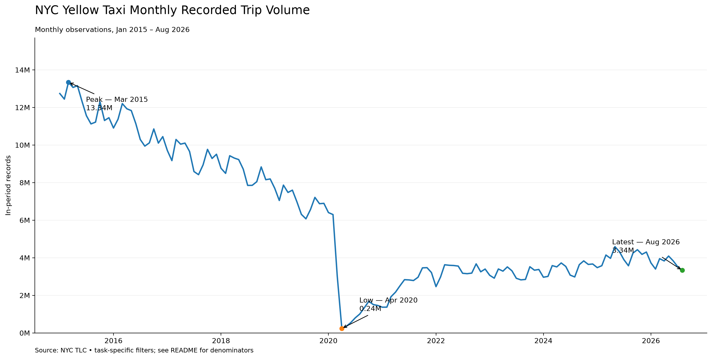
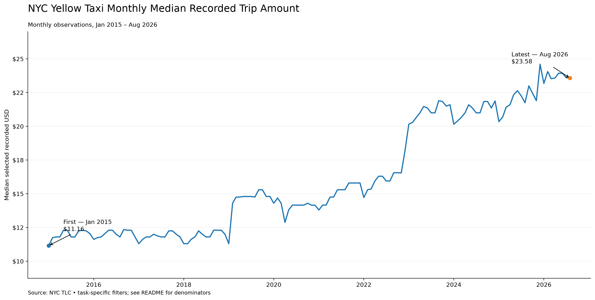
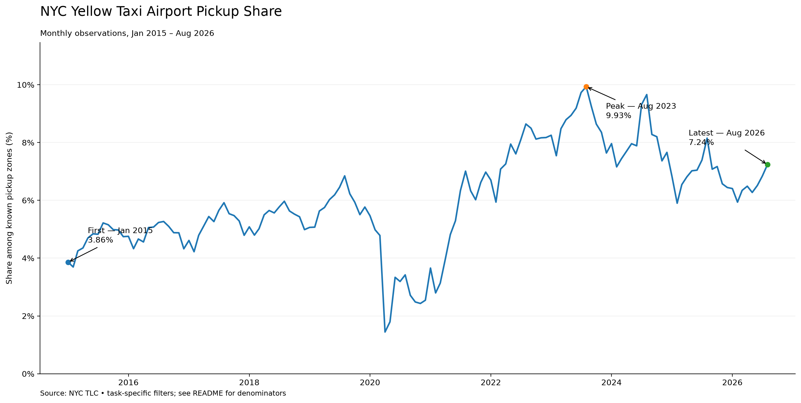

# NYC Yellow Taxi Analysis

An end-to-end Python analysis of **831 million NYC Yellow Taxi trip records**, covering **140 months from January 2015 through August 2026**.

The project examines how recorded taxi activity, trip characteristics, amounts charged, airport pickups and payment categories changed over more than eleven years. It combines exploratory analysis with reusable processing code, data-quality diagnostics and automated tests.

**Python · pandas · NumPy · PyArrow · Matplotlib · Jupyter · pytest · uv**

## Key findings

All comparisons between 2015, 2019 and 2026 use **January–August** to maintain the same seasonal coverage. Duration, distance, speed and per-trip amount comparisons use **averages of monthly medians**, not medians pooled across all trips.

### 1. Recorded taxi activity declined before the pandemic and remains below 2019 levels

Average monthly recorded trips fell from **12.47 million in 2015** to **7.13 million in 2019**, a decline of **42.82%** before the pandemic. In 2026, the comparable monthly average was **3.71 million**, **47.92% below 2019**.

The historical peak was **13,342,951 records in March 2015**. Activity reached its lowest point in **April 2020, with 237,941 records**, **96.82% below April 2019**.

These figures describe reported Yellow Taxi activity; they do not directly measure unmet passenger demand or activity across all transport services.



### 2. Selected trips became longer, while typical calculated speed declined

Between the comparable 2019 and 2026 periods:

- Average monthly median duration increased from **11.11 to 14.10 minutes** (**+26.85%**).
- Average monthly median distance increased from **1.655 to 1.933 miles** (**+16.77%**).
- Average monthly median speed decreased from **10.01 to 9.29 mph** (**−7.17%**).

These patterns describe changes in selected trip distributions. They do not isolate the effects of congestion, route mix or other factors.

### 3. Recorded amounts per trip increased, but monthly monetary totals remained lower

Average monthly median recorded total amount increased from **$14.28 in 2019** to **$23.68 in 2026**, an increase of **65.76%**.

Over the same months, the average monthly sum of monetary-valid records decreased from **$135.33 million** to **$112.24 million** (**−17.07%**). The higher recorded amount per trip therefore coincided with a lower aggregate selected amount and substantially fewer recorded trips.

Amounts are nominal. `total_amount` includes multiple fare components and should not be interpreted as net driver or company revenue.



### 4. Airport pickups represented a larger share of the selected market

Airport pickup share among records with known pickup zones increased from **4.45% in 2015** to **5.84% in 2019** and **6.50% in 2026**.

Airport zones include **JFK, LaGuardia and Newark**. A larger share does not necessarily mean more airport trips in absolute terms. The monthly series also shows that this share did not increase continuously throughout the study period.



### 5. Payment-category changes affect the interpretation of card usage

Credit-card share of all in-period records was **71.57% in 2019** and **63.77% in 2026**. However, the share of records coded as Flex Fare reached **25.98% in 2026**.

Among records with payment codes **1–4**, credit-card share increased from **71.91% to 86.15%**. This comparison excludes Flex Fare, unknown, voided and unrecognized payment categories. The lower overall card share should therefore not be read as a simple shift from cards to cash.

## Comparable-period summary

| Metric | 2015 Jan–Aug | 2019 Jan–Aug | 2026 Jan–Aug |
|---|---:|---:|---:|
| Average monthly recorded trips | 12.47M | 7.13M | 3.71M |
| Average monthly median duration | 10.94 min | 11.11 min | 14.10 min |
| Average monthly median distance | 1.754 mi | 1.655 mi | 1.933 mi |
| Average monthly median speed | 10.71 mph | 10.01 mph | 9.29 mph |
| Average monthly median recorded total amount | $11.84 | $14.28 | $23.68 |
| Average monthly selected monetary sum | $198.72M | $135.33M | $112.24M |
| Airport pickup share among known pickup zones | 4.45% | 5.84% | 6.50% |
| Credit-card share of all in-period records | 62.46% | 71.57% | 63.77% |

Multi-month shares are calculated from summed counts and their corresponding denominators. Monthly medians are averaged with equal weight per month. Different metrics use different quality-filtered subsets.

See [the generated results report](reports/results.md) for additional figures, coverage statistics and monetary reconciliation.

## Data

| Item | Details |
|---|---|
| Source | NYC Taxi & Limousine Commission (TLC) |
| Dataset | Yellow Taxi Trip Records and Taxi Zone Lookup |
| Period | January 2015–August 2026 |
| Monthly files | 140 Parquet files |
| Raw records | 831,256,595 |
| Records within each file's nominal pickup month | 831,237,097 |
| Records outside each file's nominal pickup month | 19,498 |

Official sources: [TLC Trip Record Data](https://www.nyc.gov/site/tlc/about/tlc-trip-record-data.page) and the [Yellow Taxi data dictionary](https://www.nyc.gov/assets/tlc/downloads/pdf/data_dictionary_trip_records_yellow.pdf).

Large raw files and the processed Parquet summary are stored outside the repository. Executed notebooks, figures and the numerical report are included for reviewing the analysis without downloading the full dataset.

## Methodology

The workflow loads each monthly file, creates time and trip features, joins the taxi-zone lookup, applies task-specific analysis masks and produces a compact monthly summary. The same Python functions support both the exploratory notebooks and historical processing.

Rows are retained even when an individual field is unsuitable for analysis. For example, a missing passenger count does not exclude a record from pickup-time analysis.

| Analysis | Default selection |
|---|---|
| Activity | Pickup timestamp within the file's nominal month |
| Duration | Positive duration, at most 120 minutes |
| Distance | Positive distance, at most 60 miles |
| Speed | Selected duration and distance; finite positive speed, at most 60 mph |
| Monetary | Finite nonnegative fare, total and tip; tip no greater than total |
| Passenger count | Known integer between 0 and 6 |
| Standard rate code | Codes 1–6; missing values and code 99 remain unknown |

The duration and distance bounds are analytical windows, not universal definitions of a valid taxi trip. Positive totals above **$500** are flagged for inspection rather than automatically removed.

Monthly summaries include selected-record counts and coverage for each metric. Unknown locations remain unknown, and airport shares use known pickup zones. Monetary diagnostics separately report selected totals, finite signed totals and excluded amounts.

The [quality and sensitivity notebook](notebooks/03-quality-and-sensitivity.ipynb) compares tighter, default and wider windows on the full January 2026 file. Its median duration varies between **13.45 and 13.50 minutes**, median distance remains **1.90 miles**, and median speed remains approximately **9.43 mph** across those configurations.

## Notebooks

| Notebook | Focus |
|---|---|
| [01 — Exploration](notebooks/01-exploration.ipynb) | January 2026 data quality, distributions, time patterns, geography, airports, monetary values, passengers, payments and tips |
| [02 — Longitudinal analysis](notebooks/02-longitudinal-analysis.ipynb) | Historical trends, seasonal comparisons, airport counts and shares, payment composition and quality coverage |
| [03 — Quality and sensitivity](notebooks/03-quality-and-sensitivity.ipynb) | Monetary outliers, coverage diagnostics, statistical aggregation and threshold sensitivity |

## Reproduce the analysis

### 1. Install dependencies

Use **Python 3.13 or newer** and [uv](https://docs.astral.sh/uv/). From the repository root:

```bash
uv sync
```

### 2. Prepare the source files

Download the monthly Yellow Taxi Parquet files and taxi-zone lookup from TLC. The default layout is:

```text
~/Data/raw/nyc-taxi/
├── taxi_zone_lookup.csv
└── yellow/
    ├── 2015/
    │   ├── yellow_tripdata_2015-01.parquet
    │   └── ...
    ├── ...
    └── 2026/
        ├── yellow_tripdata_2026-01.parquet
        └── ... yellow_tripdata_2026-08.parquet
```

The processed summary is saved to `~/Data/processed/nyc-taxi/monthly_summary.parquet`. Historical processing handles one month at a time; sufficient memory is still needed for the largest monthly file and its derived features.

### 3. Process, validate and generate results

```bash
uv run python scripts/schema_audit.py
uv run python main.py --start 2015-01 --end 2026-08
uv run python scripts/validate_monthly_summary.py
uv run python scripts/generate_results.py
uv run python scripts/execute_notebooks.py
```

Compatible checkpoints allow interrupted processing to resume. Changed rules, lookup contents or source metadata require rebuilding:

```bash
uv run python main.py --start 2015-01 --end 2026-08 --rebuild
```

`--rebuild` replaces the output checkpoint with the requested range. Use `--output` to choose a different destination; `--data-dir` and `--zone-file` support custom source locations. In notebooks, `NYC_TAXI_RAW_DIR` and `NYC_TAXI_SUMMARY` override the default paths.

To explore interactively:

```bash
uv run jupyter lab
```

## Validation

The complete 140-month dataset was reprocessed, and all three notebooks were executed from fresh kernels. **All 67 automated test cases pass.**

```bash
uv run pytest
```

Tests cover feature engineering, unknown and invalid values, analysis masks, aggregation denominators, incomplete comparison windows, checkpoint reuse and failure handling. Summary validation checks monthly continuity, counts, percentages, metric availability and monetary reconciliation. Checkpoints are saved through a temporary file before replacement.

## Project structure

```text
nyc-taxi/
├── main.py                 # Monthly-processing CLI
├── notebooks/              # Three executed analysis notebooks
├── src/nyc_taxi/            # Features, cleaning, aggregation and processing
├── scripts/                # Schema audit, validation, reports and notebook execution
├── tests/                  # Automated tests
├── reports/
│   ├── figures/            # Longitudinal charts
│   └── results.md          # Generated numerical findings
├── pyproject.toml
└── uv.lock
```

## Limitations

- Reported Yellow Taxi activity does not represent all NYC travel or unmet passenger demand.
- Trip mix, vendor coverage, missingness and payment categories can change over time and influence observed trends.
- Monetary values are nominal, include multiple components and are not net revenue. Cash tips are absent from the recorded tip field.
- Monthly medians cannot reconstruct exact pooled medians across years. Each metric may describe a different selected subset.
- Correlation does not establish causation. The exploratory hourly activity–speed correlation uses 24 hourly aggregates.
- The 2026 dataset is a partial year. Cross-year comparisons use matching January–August windows, and threshold sensitivity is checked for January 2026 only.

## Project purpose

This portfolio project demonstrates Python-based analysis of large datasets, explicit data-quality decisions, reusable processing, statistical interpretation, testing and communication of analytical findings. It provides a foundation for further work in inflation-adjusted analysis, geographic segmentation and forecasting.
